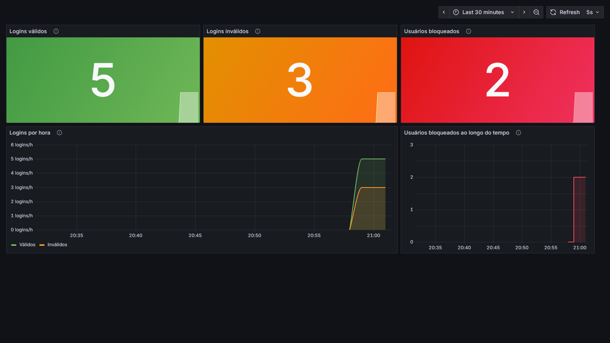
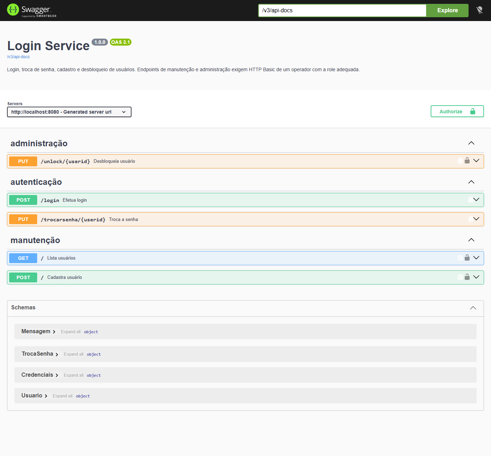

# MS-AV-02 – Segurança e Observabilidade

Microsserviço de login em Spring Boot com:

- **Segurança**: Spring Security com `JdbcUserDetailsManager` e roles (`ROLE_ADMIN`, `ROLE_MANUTENCAO`), HTTP Basic, sessão stateless e bloqueio de usuário após falhas de login
- **Métricas**: Actuator + Micrometer/Prometheus com indicadores próprios, e um dashboard no Grafana
- **Documentação**: OpenAPI 3.1 com a interface Swagger (springdoc)

Stack: Java 21, Spring Boot 4.1.2, H2 em memória, springdoc-openapi 3.1.1, Prometheus e Grafana (via Docker Compose).

## Como executar

```bash
# 1. Serviço (porta 8080)
./mvnw spring-boot:run          # Windows: mvnw.cmd spring-boot:run

# 2. Prometheus (9090) e Grafana (3000) – o dashboard já é provisionado automaticamente
docker compose up -d
```

Para o dashboard exibir dados, faça algumas chamadas ao serviço, como as da seção [Comandos principais](#comandos-principais).

| Recurso | URL |
|---|---|
| Swagger UI | http://localhost:8080/swagger-ui/index.html |
| OpenAPI (JSON / YAML) | http://localhost:8080/v3/api-docs · http://localhost:8080/v3/api-docs.yaml |
| Actuator | http://localhost:8080/actuator/health · http://localhost:8080/actuator/prometheus |
| Console H2 | http://localhost:8080/h2-console (JDBC URL `jdbc:h2:mem:logindb`, usuário `sa`, senha `password`) |
| Prometheus | http://localhost:9090 |
| Grafana | http://localhost:3000/d/login-service (usuário `admin` / senha `admin`) |

Testes automatizados: `./mvnw test`.

## Prints

### Dashboard Grafana



O dashboard mostra três indicadores: logins válidos, logins inválidos e usuários bloqueados. Abaixo deles há dois gráficos. O primeiro mostra os logins por hora (válidos × inválidos): a cada minuto, a quantidade de logins da última hora. O segundo mostra a evolução dos usuários bloqueados.

### Swagger UI



Os endpoints estão agrupados nas tags *administração*, *autenticação* e *manutenção*. Os que exigem HTTP Basic aparecem com um cadeado, e as credenciais são informadas no botão **Authorize**.

## Endpoints

| Método | Caminho | Acesso | Corpo | Respostas |
|---|---|---|---|---|
| POST | `/login` | público | `{"username": "", "senha": ""}` | 200 válido · 401 inválido ou bloqueado · 400 corpo inválido |
| PUT | `/trocarsenha/{userid}` | público | `{"atual": "", "nova": ""}` | 200 · 401 senha atual errada · 404 usuário inexistente · 423 bloqueado · 400 nova senha inválida |
| POST | `/` | `ROLE_MANUTENCAO` | `{"username": "", "senha": ""}` | 201 · 409 já existe · 401 sem credenciais · 403 sem a role |
| GET | `/` | `ROLE_MANUTENCAO` | – | 200 lista de usuários (sem senhas) · 401 · 403 |
| PUT | `/unlock/{userid}` | `ROLE_ADMIN` | – | 200 · 404 · 401 · 403 |

Nos endpoints protegidos, envie as credenciais do operador via HTTP Basic. No Swagger, use o botão **Authorize**. Os exemplos de chamada estão na seção [Comandos principais](#comandos-principais) e no arquivo [requests.http](requests.http).

## Comandos principais

Com o serviço rodando em `http://localhost:8080`:

```bash
# Login válido -> 200
curl -i -X POST http://localhost:8080/login \
  -H "Content-Type: application/json" \
  -d '{"username":"joao","senha":"joao123"}'

# Login inválido -> 401 (a segunda falha seguida bloqueia o usuário)
curl -i -X POST http://localhost:8080/login \
  -H "Content-Type: application/json" \
  -d '{"username":"maria","senha":"errada"}'

# Usuário bloqueado -> 401 mesmo com a senha correta
curl -i -X POST http://localhost:8080/login \
  -H "Content-Type: application/json" \
  -d '{"username":"maria","senha":"maria123"}'

# Troca de senha (público) -> 200
curl -i -X PUT http://localhost:8080/trocarsenha/joao \
  -H "Content-Type: application/json" \
  -d '{"atual":"joao123","nova":"joao456"}'

# Cadastro de usuário (ROLE_MANUTENCAO) -> 201
curl -i -u manutencao:manut123 -X POST http://localhost:8080/ \
  -H "Content-Type: application/json" \
  -d '{"username":"ana","senha":"ana123"}'

# Lista de usuários com a situação de bloqueio (ROLE_MANUTENCAO) -> 200
curl -u manutencao:manut123 http://localhost:8080/

# Desbloqueio (ROLE_ADMIN) -> 200
curl -i -u admin:admin123 -X PUT http://localhost:8080/unlock/maria

# Desbloqueio com operador sem a role ADMIN -> 403
curl -i -u manutencao:manut123 -X PUT http://localhost:8080/unlock/maria

# Indicadores de login no formato Prometheus
curl -s http://localhost:8080/actuator/prometheus | grep -E "^(login_|usuarios_)"
```

> **Windows (PowerShell):** use `curl.exe` em vez de `curl` (que lá é um alias do `Invoke-WebRequest`) e escreva cada comando em uma única linha, sem as `\`. Outra opção é rodar os exemplos pelo Git Bash ou pelo arquivo [requests.http](requests.http), com a extensão REST Client do VS Code.

## Usuários

Existem dois tipos de usuário:

**Operadores da API.** Ficam nas tabelas `users` e `authorities`, que é o schema padrão do `JdbcUserDetailsManager`. São criados na inicialização por `SecurityConfig`, com senha em BCrypt:

| Usuário | Senha | Role |
|---|---|---|
| `admin` | `admin123` | `ROLE_ADMIN` |
| `manutencao` | `manut123` | `ROLE_MANUTENCAO` |

As credenciais podem ser alteradas nas propriedades `seguranca.*` do `application.properties`.

**Usuários do sistema.** Ficam na tabela `usuarios` e são validados pelo `POST /login`. Usuários de exemplo: `joao`/`joao123`, `maria`/`maria123` e `pedro`/`pedro123`.

## Regra de bloqueio

- Cada login com senha errada incrementa `login_attempts.failed_attempts`.
- Quando o usuário falha **mais de uma vez** seguida, ele é bloqueado: `locked = TRUE` e `locked_at` é preenchido. O limite é configurável em `login.max-falhas=1`.
- Um usuário bloqueado recebe 401 mesmo informando a senha correta, até que um administrador chame `PUT /unlock/{userid}`.
- Um login válido zera as falhas.
- No `PUT /trocarsenha/{userid}`, a senha atual errada também conta como falha. Como o endpoint é público, isso impede usá-lo para descobrir senhas por tentativa e erro.

## Métricas

| Métrica (Prometheus) | Tipo | Significado |
|---|---|---|
| `login_validos_total` | counter | quantidade de logins válidos |
| `login_invalidos_total` | counter | quantidade de logins inválidos (senha errada, usuário inexistente ou bloqueado) |
| `usuarios_bloqueados` | gauge | total de usuários com `locked = TRUE` em `login_attempts` |

As métricas estão implementadas em [LoginMetricas.java](src/main/java/br/com/faculdade/login/metrics/LoginMetricas.java).

O dashboard exportado (JSON model) está em [observabilidade/grafana/dashboards/login-service.json](observabilidade/grafana/dashboards/login-service.json) e é carregado automaticamente pelo Grafana do `docker-compose.yml`. Para importar em outro Grafana, use *Dashboards → New → Import* e selecione esse arquivo. O datasource Prometheus deve ter o uid `prometheus`.

## Estrutura

```
src/main/java/br/com/faculdade/login
├── config/        SecurityConfig (regras, JdbcUserDetailsManager, operadores) e OpenApiConfig
├── controller/    UsuarioController (endpoints + anotações OpenAPI)
├── service/       LoginService (login, bloqueio, troca de senha, cadastro, desbloqueio)
├── repository/    UsuarioRepository e LoginAttemptRepository (JdbcClient)
├── metrics/       LoginMetricas (counters e gauge)
├── dto/           records de requisição e resposta
└── exception/     NegocioException e TratadorErros
src/main/resources  application.properties, schema.sql, data.sql
observabilidade/    configuração do Prometheus e provisionamento do Grafana
docs/               prints do Grafana e do Swagger, openapi.yaml gerado
```

## Observações

- O script SQL do enunciado tem uma vírgula sobrando após `updated_at`, o que gera erro de sintaxe. Em [schema.sql](src/main/resources/schema.sql) ela foi removida.
- A coluna `usuarios.senha VARCHAR(10)` definida no enunciado não comporta um hash, então as senhas dos usuários do sistema ficam em texto puro, como pede o schema. Já as senhas dos operadores (`users`) usam BCrypt.
- O banco é H2 em memória e os contadores ficam na memória da aplicação, então tudo é zerado ao reiniciar o serviço.
- `/actuator/prometheus`, `/actuator/health` e o console H2 estão liberados para facilitar a execução local. Os demais endpoints do actuator exigem `ROLE_ADMIN`.
